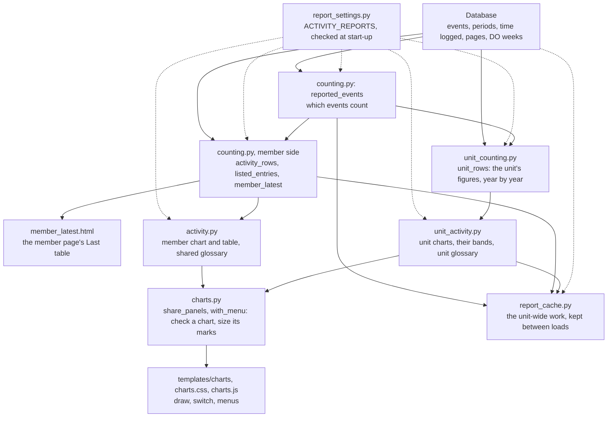

# Activity reports

Three pages count what members do: a member's activity report, the "Last" table on the member page, and the
unit activity report. They share one set of rules, written once, in plain words, in the glossary at the foot
of each report. This page shows where each rule lives in the code, which setting changes it, and which tests
prove it.

## How a report is built

Solid arrows: what each step hands the next; the counting steps read the database through the events that
count. Dashed: the team's rules, which each step that applies one reads from `report_settings()`, and the
database's fingerprint, which the cache checks on every load.

- `main/lib/counting.py` owns the rules both reports share: which events count, how logged time becomes days
  and hours, time logged twice, the end of today, whether an operation ran and why not, and where a member's
  report starts. It also counts a member's figures.
- `main/lib/unit_counting.py` counts the unit's figures; `main/lib/activity.py` and `main/lib/unit_activity.py`
  turn each report's figures into charts, tables and glossary rows.
- `main/lib/charts.py` and `templates/charts/` are the chart component: one small set of panels per chart,
  switches that work without script, and a figures box for each column.
- `main/models/event.py` reads an event's leaders text for the members it names, for the event page and for
  who led.
- `main/lib/report_settings.py` holds every rule a team may change, with BAMRU's values as the defaults. At
  start-up it warns, naming its key, of a value of the wrong kind or out of its range, a number that is not
  finite, or a pattern Postgres would read otherwise than Python; that key keeps its default and the team's
  other keys apply, so the reports only ever run on checked values.
- `main/lib/report_cache.py` keeps the unit-wide work between page loads (below).

## The cache

Three values are kept between page loads, in each server worker's own memory (Django's default cache): the unit
report's figures, the first day both reports count from (which the member page reads too), and what the unit did
from that day on, from which every member's report draws its unit columns. Each has one entry, with what it was
built from, replaced when it is built again, so a worker holds three. The pages are not kept, only these values,
so each page still carries its reader's own menus. The counting functions stay as they were; the views hand them
the kept values, and a member's report asks for the unit's days only for a member with something to count.

A kept value is used only while everything it was built from still holds:

- **The data.** Each page load reads, in one query, for each table its values read, the count of rows and the
  latest `updated_at`. An edit or an addition moves the latest time, as every model the reports read sets it on
  save; a deletion moves the count. So a correction shows on the next load, in every worker. Each value has its
  own tables: a page rebuilds the first day but not the unit's days, and a reply or a busy period rebuilds
  neither, only the unit report.
  A member's status history is not read for it, as every login adds a row there; a change of status is a save
  of the member, which moves the members' count or time.
- **The team's rules** (`report_settings()`) and the time zone.
- **The time.** The reports read it (an event counts once it has begun, an operation once it has finished, a DO
  week once its shift starts, nothing after today), so a value is used for at most 5 minutes (`EXPIRY`) after
  the moment it was built for, and on one local date.

What it cannot see, each for at most those 5 minutes, and in the worker that holds the value:

- A write that does not go through a model's full save: a queryset's `update()`, a `save(update_fields=…)`,
  `loaddata`, or SQL run at the database. The site's code has none today. `test_no_code_of_the_site_writes_past_save` is a tripwire for the
  common forms of one in the site's code and its migrations, not a proof that there is none.
- Rows of the status history deleted or cleaned up, as simple_history's clean-up commands do: the history is not
  watched at all.
- A change of status read in the moment between the member's row being saved and its history row, which is
  written just after it in a statement of its own. The history is left out of the fingerprint on purpose, as
  every login adds a row to it.
- An edit stamped earlier than the latest edit before it, as when it commits after a later-stamped one, or is
  saved by a server whose clock is behind.

`test_report_cache.ReportCacheTestCase` writes to each table each value reads, with an edit, an addition and a
deletion, and checks that the value on its next load equals one built afresh at the same moment; and that the
rules, the time zone, the date and a later span of the expiry each give a value of their own.

## Rules, settings and tests

Each rule's key is in `ACTIVITY_REPORTS` (see the README); "—" means the rule is fixed. Tests are named as
module, class and method in `main/tests/`.

| Rule | Key | Tests |
|---|---|---|
| Any time logged for an event or operating period counts as at least one day attended, however short. Up to 12 hours counts as one day, even if it runs past midnight. That day is the date most of the time fell on. More than 12 hours counts each date with at least 2 hours on it. The glossary gives a worked example of each rule at the default `DAY_HOURS` and `SINGLE_DAY_HOURS`, and leaves them out under a team's own. | `DAY_HOURS`, `SINGLE_DAY_HOURS` | `test_counting.DaysTestCase.test_days` `test_counting.DaysTestCase.test_the_glossary_s_examples_count_as_it_says` `test_report_settings.TeamRulesTestCase.test_day_hours_and_single_day_hours` |
| Each logged time's hours are shown on the day or days it counts as. When a logged time has hours on a date that does not count for it, they are added to the nearest date that does. No hours are lost this way. The unit's active hours stay on the calendar days they fell on. | — | `test_counting.ActivityRowsTestCase.test_hours_go_to_the_days_they_fell_on` `test_unit_activity.UnitActivityTestCase.test_the_units_hours_stay_on_the_days_they_fell_on_and_members_go_with_their_days` |
| Hours are time that passed; the 7 days an entry may run to are counted on the local clock, whatever the clocks did. | `MAX_ENTRY_DAYS` | `test_counting.DaysTestCase.test_daylight_saving` `test_counting.DaysTestCase.test_seven_days_by_the_clock_in_the_weeks_the_clocks_change` |
| Time logged twice, on two periods or events at once, counts once, for the one that began first. | — | `test_counting.OverlappingTimeTestCase.test_time_logged_twice_counts_once` `test_unit_activity.UnitActivityTestCase.test_time_logged_within_other_time_counts_once` |
| On a member's report, a row of the event lists shows the hours and days it counts, then any it doesn't after a mark: † for hours another row counts (time logged twice) and for days another row of the same list keeps (a date counts once for each type, for the row whose time began first, as time logged twice does), ‡ for hours left out by the rules below. A row's three amounts of hours add up to its logged time, and each list's own days to its type's days in the table. The table's Total column counts a date with two types once, as the chart's All panel does, so its days can be fewer than all the lists' days added together; its hours are all the lists' counted hours added together. The lists mark no date across types. A screen reader reads each mark as words, a line under a list says what the marks it shows mean, and the glossary's "† ‡ Hours and days not added" gives a worked example, which holds under any day rules and is left out where an entry may run no more than a day. Nothing is shown in parentheses, which read as a negative number. A time that ends before it starts, or runs outside the dates the counting can hold (`EARLIEST` to `LATEST` in counting.py, years 1 to 9999), is no time: its row shows 0 and no mark, as the totals count it, and the errors report lists it. | — | `test_counting.OverlappingTimeTestCase.test_the_glossary_s_example_of_hours_and_days_counted_on_another_row` `test_counting.OverlappingTimeTestCase.test_a_date_counts_once_in_each_type_s_list_for_the_row_whose_time_began_first` `test_counting.CountedAgainstTheRulesTestCase.test_each_list_s_days_and_hours_add_up_to_its_type_s_in_the_table` `test_counting.OverlappingTimeTestCase.test_a_row_s_hours_not_counted_are_split_into_another_row_s_and_none_s` `test_member_report.ReportPagesTestCase.test_the_lists_mark_hours_not_added_and_say_why_under_each_list_that_has_them` `test_member_report.ReportPagesTestCase.test_a_row_whose_time_ends_before_it_starts_shows_no_hours_and_no_mark` `test_member_report.ReportPagesTestCase.test_a_row_marks_its_days_counted_on_another_row_of_its_list` |
| More than 7 days logged by one member for one event or period counts one day and no hours. | `MAX_ENTRY_DAYS` | `test_counting.ActivityRowsTestCase.test_an_entry_too_long_to_be_right` `test_report_settings.TeamRulesTestCase.test_max_entry_days` |
| A day after today counts nothing yet, nor does an event that has not started, whatever its times. Hours logged after the end of today count nothing yet, for a member as for the unit, though they may decide which day the time counts for. | — | `test_counting.ActivityRowsTestCase.test_time_entered_for_a_day_after_today_is_not_counted_yet` `test_counting.EntryDaysTestCase.test_an_event_still_to_start_counts_nothing_whatever_its_times` `test_counting.ActivityRowsTestCase.test_hours_after_tonight_s_midnight_count_nothing_yet_though_they_choose_the_day` |
| Guests are those whose status today is a guest's; their time counts only on their own report. A former guest who is now a member counts as a member for all their time, including time logged while they were a guest. Former members count. The no-contact statuses (`Member.NO_CONTACT`) are sensitive: they count as any other status, the guest one as a guest, but no page of the reports shows their names or codes, so the glossary's Guests entry names guest statuses only as examples, leaving those out. | — | `test_counting.ActivityRowsTestCase.test_alumni_count_towards_the_units_days_and_guests_do_not` `test_unit_activity.UnitActivityTestCase.test_members_who_have_left_count_and_guests_do_not` `test_member_report.ReportPagesTestCase.test_the_guests_entry_names_guest_statuses_but_no_no_contact_one_whatever_the_statuses` `test_member_report.ReportPagesTestCase.test_no_page_of_the_reports_names_a_no_contact_status` |
| Events count whether published or not. | — | `test_counting.EventsAttendedTestCase.test_unpublished_events_count` `test_unit_activity.UnitActivityTestCase.test_events_count_whether_published_or_not` |
| Events whose titles the team's settings mark as tests or demonstrations aren't counted. This pattern and `HEADS_UP_TITLE` run in the database, so a team's pattern keeps the default, with a warning at start-up, unless Postgres reads it as Python does: braces only as a bound, `{n}`, `{n,}` or `{n,m}` up to 255, and none on a group with a bound inside; a hyphen in a class only first, last, escaped or between two plain characters, the first not the end of another range; no quantifier after a lookaround, and no `\b`. | `TEST_TITLE`, `HEADS_UP_TITLE` | `test_counting.ReportedEventsTestCase.test_test_and_demo_events_are_left_out` `test_report_settings.TeamRulesTestCase.test_test_title` `test_report_settings.ReportSettingsTestCase.test_a_wrong_value_is_refused_at_start_up_naming_its_key` |
| From the first page sent for an operation, other than a test's or a demonstration's, an operation with no page sent, nobody listed and no title calling it a heads-up was never used: it isn't counted. A page sent with the event page's Test button is no page for either report. | `HEADS_UP_TITLE` | `test_counting.ReportedEventsTestCase.test_operations_never_used_are_left_out` `test_counting.PagingHistoryTestCase.test_with_no_page_recorded_no_operation_is_left_out_as_never_used` `test_counting.PagingHistoryTestCase.test_pages_were_first_recorded_on_the_first_page_for_an_operation_a_report_counts` `test_report_settings.TeamRulesTestCase.test_heads_up_title` `test_counting.PagingHistoryTestCase.test_a_page_sent_with_the_test_button_is_no_page_for_the_reports` `test_unit_activity.UnitActivityTestCase.test_a_page_sent_with_the_test_button_is_not_an_operations_first_page_nor_a_callout` |
| Only operations, trainings, meetings and community events count. | — | `test_member_report.ReportPagesTestCase.test_report_with_an_unknown_type_of_event` |
| On an operation, the OL in the field led it; elsewhere, those named in its leaders text or flagged OL did. The member page's Last table has a line of its own for the last day in the field as OL on an operation, under the line for the last day in the field, whenever the member has been OL, even when it is the same day; it counts as the report's OL days do, from the member's entries alone. | — | `test_counting.EntryLedTestCase.test_who_led` `test_event_page.EventLeadersTestCase.test_members_named` `test_member_page.MemberLatestTestCase.test_the_last_operation_as_ol_is_a_line_of_its_own` `test_member_page.MemberLatestTestCase.test_ol_is_counted_as_the_other_lines_are` |
| An operation ran once a member in the field, not a guest, has a day attended on it or a departure logged up to today; it has finished once its start and its finish are both past. | — | `test_member_page.MemberLatestTestCase.test_an_operation_only_a_guest_logged_time_on_did_not_run` `test_unit_activity.UnitActivityTestCase.test_operations_by_responders_and_called_off` `test_member_page.MemberLatestTestCase.test_an_operation_saved_finishing_before_it_starts_has_not_finished_until_it_has_started` `test_member_page.MemberLatestTestCase.test_a_departure_logged_with_no_return_yet_means_the_operation_ran` `test_unit_activity.UnitActivityTestCase.test_a_departure_counts_before_its_member_logs_a_return` `test_unit_activity.UnitActivityTestCase.test_a_member_who_has_left_is_one_of_an_operations_responders_beside_those_with_a_day` `test_member_page.MemberLatestTestCase.test_whether_an_operation_ran_is_read_from_the_unit_s_first_year_on_as_the_unit_report_reads_it` |
| An operation that did not run was called off if an availability page, with the callout reply template, went out for it, and only a heads-up if not. Before the first page with either reply template, or with none, its title decides: a heads-up if its title says so. A member listed on one called off stood down from it, unless it began before 2013, when whether it ran is not known. | `CALLOUT_TEMPLATE`, `HEADS_UP_TEMPLATE`, `HEADS_UP_TITLE`, `OPERATION_TIMES_FROM` | `test_counting.PagingHistoryTestCase.test_with_no_page_that_carried_a_reply_template_only_the_title_tells` `test_report_settings.TeamRulesTestCase.test_callout_template` `test_unit_activity.UnitActivityTestCase.test_a_teams_heads_up_template_tells_an_operation_only_warned_of` `test_report_settings.TeamRulesTestCase.test_heads_up_title` `test_member_page.MemberLatestTestCase.test_stood_down_once_the_operation_has_finished` `test_member_page.MemberLatestTestCase.test_no_stood_down_line_for_an_operation_begun_before_operation_times_were_logged` |
| An operation had few responders, some or many. Each band names responders, and one whose ends are the same is one number. | `RESPONDERS_THIN`, `RESPONDERS_FULL` | `test_unit_activity.UnitActivityTestCase.test_a_team_sets_how_many_responders_are_few_and_how_many_many` |
| Callout pages are an operation's pages with the callout or the heads-up reply template. A member's reply to one, and to its repages, is timed once, from the first. A member in one of their busy periods (Unavailable) on the local day of the first page is left out of it, reply or none. Busy periods are read as they stand today: the site keeps no history of them, so a period edited later changes the reply charts of the past too. | `REPLY_MINUTES`, `CALLOUT_TEMPLATE`, `HEADS_UP_TEMPLATE` | `test_unit_activity.UnitActivityTestCase.test_replies_to_callout_pages_by_how_soon` `test_unit_activity.UnitActivityTestCase.test_a_team_sets_how_soon_a_reply_or_a_departure_is_quick` `test_unit_activity.UnitActivityTestCase.test_a_team_names_the_reply_template_of_its_heads_up_pages` `test_unit_activity.UnitActivityTestCase.test_pages_for_events_other_than_operations_are_not_callout_pages` `test_unit_activity.UnitActivityTestCase.test_a_member_busy_on_the_day_of_a_callout_is_left_out_of_it` |
| An immediate callout is an operation with a callout page that says "Immediate": at its start, after the operation's name and number as the page form begins a page, or after a repage, reply, forward or update prefix. It counts once the operation has begun, timed from the first such page to the first departure logged at or after it by a member in the field, not a guest or the AHC, up to today. | `IMMEDIATE_CALLOUT`, `IMMEDIATE_CALLOUT_SAID`, `DEPARTURE_MINUTES`, `CALLOUT_TEMPLATE`, `HEADS_UP_TEMPLATE` | `test_unit_activity.UnitActivityTestCase.test_which_pages_start_an_immediate_callout` `test_report_settings.TeamRulesTestCase.test_the_immediate_callout_sentence_says_what_the_default_pattern_matches` `test_unit_activity.UnitActivityTestCase.test_immediate_callouts_by_how_soon_the_first_responder_left` `test_unit_activity.UnitActivityTestCase.test_a_guests_departure_and_one_after_today_are_left_out` |
| A one-day stretch in the field of more than 12 hours, door to door, is a long day; a longer stretch is counted by its days. A team may set up to 8784 hours, a leap year's. | `LONG_DAY` | `test_unit_activity.UnitActivityTestCase.test_a_team_sets_how_many_hours_make_a_long_day` `test_unit_activity.UnitActivityTestCase.test_twelve_hours_logged_in_three_parts_are_not_a_long_day` `test_report_settings.ReportSettingsTestCase.test_a_wrong_value_is_refused_at_start_up_naming_its_key` |
| A member joined on their third day at operations or at trainings not open to guests; with fewer than three such days, on their first event of any type. The glossary may add how well the rule agrees with the team's own record of when members joined. | `JOINED_AT`, `GUEST_FRIENDLY_TITLE`, `JOINED_CHECKED` | `test_unit_activity.UnitActivityTestCase.test_a_team_sets_on_how_many_days_a_member_has_joined` `test_unit_activity.UnitActivityTestCase.test_a_team_sets_which_trainings_are_open_to_guests` `test_unit_activity.UnitActivityTestCase.test_a_team_says_how_its_joining_rule_was_checked_or_nothing` `test_report_settings.RefusedValueTestCase.test_a_team_may_say_nothing_of_how_its_joining_rule_was_checked_but_not_give_a_number` |
| A member is active in every calendar year from joining to the year of their last operation, training or community event, but for the years between becoming inactive and being reactivated. They have become inactive after 12 calendar months without one; the chart of members joining and becoming inactive can be switched to 24 or 36, but the active-members chart always reads 12. Meetings do not keep a member active, though the day a member joins counts, whatever its event. Every year has its net change, the current year's too, as known on the day: until the months have passed since a year's end, it counts those who have become inactive so far. The pages say inactive and reactivated, never left or came back: the records show a member's activity stopping and starting again, not why. | `LEFT_AFTER` | `test_unit_activity.UnitActivityTestCase.test_meetings_do_not_keep_a_member_active` `test_unit_activity.UnitActivityTestCase.test_a_team_sets_the_months_after_which_a_member_has_left` `test_unit_activity.UnitActivityTestCase.test_every_year_has_its_net_change_as_known_so_far` `test_unit_activity.UnitActivityTestCase.test_the_membership_charts_and_terms_never_say_left_or_came_back` |
| Responders are counted under the status they held on the day; some statuses have a band of their own, and the rest, with members who have no recorded status, are Other status. Time before statuses were first recorded is not counted by status. A band is named by its status, so a no-contact status is never given one: a team's setting that bands one is refused, with a warning, and the default kept. | `BANDED_STATUSES` | `test_unit_activity.UnitActivityTestCase.test_responders_by_the_status_they_held_on_the_day` `test_unit_activity.UnitActivityTestCase.test_a_team_sets_which_statuses_have_a_band_of_their_own` `test_report_settings.NoContactTestCase.test_a_no_contact_status_is_never_given_a_band_of_its_own` |
| What is read from operation times is grey before the year they were first logged, on every chart that reads them. | `OPERATION_TIMES_FROM` | `test_unit_activity.UnitActivityTestCase.test_a_team_sets_the_year_from_which_operation_times_were_logged` `test_unit_activity.UnitActivityTestCase.test_what_is_read_from_operation_times_is_grey_before_they_were_logged` |
| A run of 3 or more empty years cuts off a stray early record. The unit's first year is read from what the reports count by now: an event with a member's day attended in its year or later, an operation that has finished, a DO week begun, of a real quarter and week. Neither report counts anything dated before it, and an entry of an event dated earlier claims no time. | `STRAY_BEFORE` | `test_unit_activity.UnitActivityTestCase.test_a_team_sets_how_many_empty_years_mark_a_stray_record` `test_counting.RecordsFromTestCase.test_a_time_typed_in_a_year_long_before_the_unit_s_counts_nowhere` `test_counting.RecordsFromTestCase.test_only_what_a_report_counts_by_now_starts_the_records` `test_counting.RecordsFromTestCase.test_an_entry_of_an_event_dated_before_the_records_claims_no_time_and_makes_no_unit_day` `test_counting.RecordsFromTestCase.test_a_do_row_that_is_not_a_real_week_counts_nowhere_and_raises_nothing` `test_counting.RecordsFromTestCase.test_a_year_starts_the_records_only_with_a_day_a_report_counts_in_it` |
| An assigned DO week counts once its shift starts, in the month and year that hold most of its days; in its first three days, on today. | — | `test_counting.ActivityRowsTestCase.test_a_do_week_counts_in_the_year_that_holds_most_of_its_days` `test_counting.RecordsFromTestCase.test_a_do_week_begun_in_december_counts_when_it_starts_the_records` |
| Hours are written to one decimal, half up, the same in every table, chart and list. | — | `test_charts.ChartsTestCase.test_hours_are_written_to_one_decimal` `test_member_report.ReportPagesTestCase.test_an_entrys_row_and_the_totals_round_its_hours_alike` |
| A team's value of the wrong kind or out of its range, or a number that is not finite, keeps its key's default, with a warning at start-up (`main.W001`) naming the key and why; the team's other keys apply. A good value that would leave a default wrong beside it keeps its own default instead. | — | `test_report_settings.ReportSettingsTestCase.test_a_wrong_value_is_refused_at_start_up_naming_its_key` `test_report_settings.RefusedValueTestCase.test_a_refused_value_warns_and_the_reports_use_its_default_beside_the_team_s_other_keys` `test_report_settings.RefusedValueTestCase.test_a_good_value_that_leaves_a_default_wrong_is_refused_in_its_place` `test_report_settings.RefusedValueTestCase.test_no_unchecked_value_reaches_the_reports` `test_report_settings.RefusedValueTestCase.test_both_responder_keys_given_together_never_raise` `test_report_settings.RefusedValueTestCase.test_a_thin_of_the_wrong_kind_is_refused_before_full_is_checked_against_it` `test_report_settings.RefusedValueTestCase.test_nothing_a_team_can_type_makes_the_reader_raise` |

`test_docs.ActivityReportsPageTestCase` checks this table against the code: it fails if a test named here no
longer exists, or if a key of `ReportSettings` has no row. It cannot tell whether a test proves its row's rule:
that is for review.

## Out of scope

The older Activity Summary and Activity Detail reports are unchanged and do not use these rules. To run the
tests, see the README.
