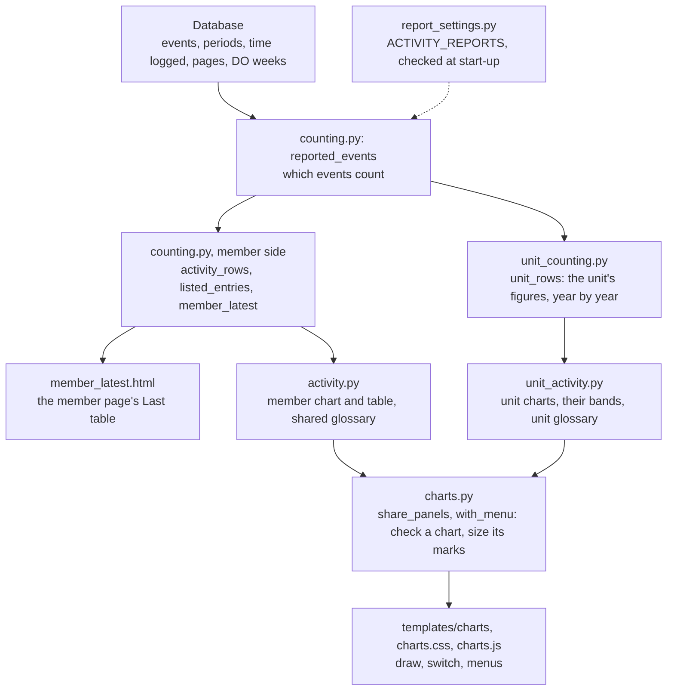

# Activity reports

Three pages count what members do: a member's activity report, the "Last" table on the member page, and the
unit activity report. They share one set of rules, written once, in plain words, in the glossary at the foot
of each report. This page shows where each rule lives in the code, which setting changes it, and which tests
prove it.

## How a report is built

Solid arrows: what each step hands the next. Dashed: the team's rules, which every counting step reads from
`report_settings()`.

- `main/lib/counting.py` owns the rules both reports share: which events count, how logged time becomes days
  and hours, time logged twice, the end of today, whether an operation ran and why not, and where a member's
  report starts. It also counts a member's figures.
- `main/lib/unit_counting.py` counts the unit's figures; `main/lib/activity.py` and `main/lib/unit_activity.py`
  turn each report's figures into charts, tables and glossary rows.
- `main/lib/charts.py` and `templates/charts/` are the chart component: one small set of panels per chart,
  switches that work without script, and a figures box for each column.
- `main/models/event.py` reads an event's leaders text for the members it names, for the event page and for
  who led.
- `main/lib/report_settings.py` holds every rule a team may change, with BAMRU's values as the defaults.

## Rules, settings and tests

Each rule's key is in `ACTIVITY_REPORTS` (see the README); "—" means the rule is fixed. Tests are named as
module, class and method in `main/tests/`.

| Rule | Key | Tests |
|---|---|---|
| A day attended has at least 2 hours logged for one event; 12 hours or less is one day, even across midnight. | `DAY_HOURS`, `SINGLE_DAY_HOURS` | `test_counting.DaysTestCase.test_days` `test_report_settings.TeamRulesTestCase.test_day_hours_and_single_day_hours` |
| Hours count on the days they fell on; a day too short to count gives them to the counted day beside it. | — | `test_counting.ActivityRowsTestCase.test_hours_go_to_the_days_they_fell_on` |
| Hours are time that passed; seven days are read on the local clock, whatever the clocks did. | — | `test_counting.DaysTestCase.test_daylight_saving` `test_counting.DaysTestCase.test_seven_days_by_the_clock_in_the_weeks_the_clocks_change` |
| Time logged twice, on two periods or events at once, counts once, for the one that began first. | — | `test_counting.OverlappingTimeTestCase.test_time_logged_twice_counts_once` `test_unit_activity.UnitActivityTestCase.test_time_logged_within_other_time_counts_once` |
| More than 7 days logged for one event or period is a mistake: one day, and no hours. | `MAX_ENTRY_DAYS` | `test_counting.ActivityRowsTestCase.test_an_entry_too_long_to_be_right` `test_report_settings.TeamRulesTestCase.test_max_entry_days` |
| A day after today counts nothing yet, nor does an event that has not started. | — | `test_counting.ActivityRowsTestCase.test_time_entered_for_a_day_after_today_is_not_counted_yet` `test_counting.OverlappingTimeTestCase.test_an_event_not_started_claims_no_time` |
| Guests are those whose status today is a guest's; their time counts only on their own report. Former members count. | — | `test_counting.ActivityRowsTestCase.test_alumni_count_towards_the_units_days_and_guests_do_not` `test_unit_activity.UnitActivityTestCase.test_members_who_have_left_count_and_guests_do_not` |
| Events count whether published or not. | — | `test_counting.EventsAttendedTestCase.test_unpublished_events_count` `test_unit_activity.UnitActivityTestCase.test_events_count_whether_published_or_not` |
| Test and demonstration events count nowhere, by their title. | `TEST_TITLE` | `test_counting.ReportedEventsTestCase.test_test_and_demo_events_are_left_out` `test_report_settings.TeamRulesTestCase.test_test_title` |
| From the first page sent for an operation, one with no page, nobody listed and no title calling it a heads-up was never used, and counts nowhere. | `HEADS_UP_TITLE` | `test_counting.ReportedEventsTestCase.test_operations_never_used_are_left_out` `test_counting.PagingHistoryTestCase.test_with_no_page_recorded_no_operation_is_left_out_as_never_used` `test_report_settings.TeamRulesTestCase.test_heads_up_title` |
| Only operations, trainings, meetings and community events count. | — | `test_member_report.ReportPagesTestCase.test_report_with_an_unknown_type_of_event` |
| On an operation, the OL in the field led it; elsewhere, those named in its leaders text or flagged OL did. | — | `test_counting.EntryLedTestCase.test_who_led` `test_event_page.EventLeadersTestCase.test_members_named` |
| An operation ran once a member in the field, not a guest, has a day attended on it; it has finished once its start and its finish are both past. | — | `test_member_page.MemberLatestTestCase.test_an_operation_only_a_guest_logged_time_on_did_not_run` `test_unit_activity.UnitActivityTestCase.test_operations_by_responders_and_called_off` `test_member_page.MemberLatestTestCase.test_an_operation_saved_finishing_before_it_starts_has_not_finished_until_it_has_started` |
| An operation that did not run was called off if a callout page went out for it, and only a heads-up if not; before pages first said which they were, its title decides. A member listed on one called off stood down from it. | `CALLOUT_TEMPLATE`, `HEADS_UP_TEMPLATE` | `test_counting.PagingHistoryTestCase.test_with_no_page_that_carried_a_reply_template_only_the_title_tells` `test_report_settings.TeamRulesTestCase.test_callout_template` `test_unit_activity.UnitActivityTestCase.test_a_team_names_the_reply_template_of_its_heads_up_pages` `test_member_page.MemberLatestTestCase.test_stood_down_once_the_operation_has_finished` |
| An operation had few responders, some or many. | `RESPONDERS_THIN`, `RESPONDERS_FULL` | `test_unit_activity.UnitActivityTestCase.test_a_team_sets_how_many_responders_are_few_and_how_many_many` |
| A member's reply to a callout page, and its repages, is timed once, from the first. | `REPLY_MINUTES` | `test_unit_activity.UnitActivityTestCase.test_replies_to_callout_pages_by_how_soon` `test_unit_activity.UnitActivityTestCase.test_a_team_sets_how_soon_a_reply_or_a_departure_is_quick` |
| An immediate callout is one whose page starts "Immediate"; it is timed to the first responder leaving home. | `IMMEDIATE_CALLOUT`, `IMMEDIATE_CALLOUT_SAID`, `DEPARTURE_MINUTES` | `test_unit_activity.UnitActivityTestCase.test_which_pages_start_an_immediate_callout` `test_unit_activity.UnitActivityTestCase.test_immediate_callouts_by_how_soon_the_first_responder_left` |
| A day in the field of more than 12 hours, door to door, is a long day. | `LONG_DAY` | `test_unit_activity.UnitActivityTestCase.test_a_team_sets_how_many_hours_make_a_long_day` |
| A member joined on their third day at operations or at trainings not open to guests. | `JOINED_AT`, `GUEST_FRIENDLY_TITLE` | `test_unit_activity.UnitActivityTestCase.test_a_team_sets_on_how_many_days_a_member_has_joined` `test_unit_activity.UnitActivityTestCase.test_a_team_sets_which_trainings_are_open_to_guests` |
| A member is active with an operation, training or community day in the last 12 months, and has left after 12 calendar months without one; meetings do not count. | `LEFT_AFTER` | `test_unit_activity.UnitActivityTestCase.test_meetings_do_not_keep_a_member_active` `test_unit_activity.UnitActivityTestCase.test_a_team_sets_the_months_after_which_a_member_has_left` |
| Responders are counted under the status they held on the day; some statuses have a band of their own. | `BANDED_STATUSES` | `test_unit_activity.UnitActivityTestCase.test_responders_by_the_status_they_held_on_the_day` `test_unit_activity.UnitActivityTestCase.test_a_team_sets_which_statuses_have_a_band_of_their_own` |
| What is read from operation times is grey before the year they were first logged. | `OPERATION_TIMES_FROM` | `test_unit_activity.UnitActivityTestCase.test_a_team_sets_the_year_from_which_operation_times_were_logged` |
| A run of more than 3 empty years cuts off a stray early record; a member's report counts nothing before the unit's first year. | `STRAY_BEFORE` | `test_unit_activity.UnitActivityTestCase.test_a_team_sets_how_many_empty_years_mark_a_stray_record` `test_counting.RecordsFromTestCase.test_a_time_typed_in_a_year_long_before_the_unit_s_counts_nowhere` |
| An assigned DO week counts from when its shift starts, in the month and year that hold most of its days. | — | `test_counting.ActivityRowsTestCase.test_a_do_week_counts_in_the_year_that_holds_most_of_its_days` |
| Hours are written to one decimal, half up, the same in every table, chart and list. | — | `test_charts.ChartsTestCase.test_hours_are_written_to_one_decimal` `test_member_report.ReportPagesTestCase.test_an_entrys_row_and_the_totals_round_its_hours_alike` |

`test_docs.ActivityReportsPageTestCase` keeps this table true: it fails if a test named here no longer exists,
or if a key of `ReportSettings` has no row.

## Out of scope

The older Activity Summary and Activity Detail reports are unchanged and do not use these rules. To run the
tests, see the README.
